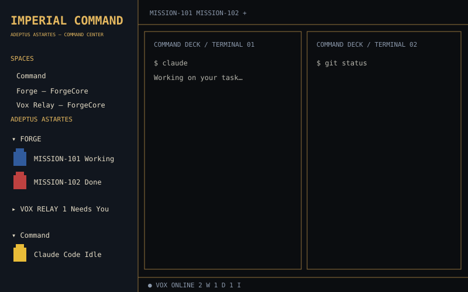

# Imperial Command — Herdr theme

Tema fan-made per **Herdr Desktop 0.1.16**, ispirato a Warhammer 40.000: interfaccia gotica oro e nero, Space Marine pixel art, progetti raggruppati e avvisi laser. Verificato su macOS con Apple Silicon.



## Funzioni

- Raggruppamento automatico degli agenti per Space, anche quando più Space usano lo stesso repository.
- Gruppi espandibili, stato persistente e contatori Working, Needs You, Done e Idle, inclusi i sub-agent.
- Otto capitoli lealisti, assegnati per indirizzo del terminale e conservati tra cambi di stato e riavvii. I capitoli liberi vengono usati prima delle ripetizioni.
- Atlas trasparente con 32 pose, animazioni native discrete e modalità **Detailed / Compact** da 78 / 56 px per riga.
- Tab, split, focus, scrolling, pin, ridimensionamento, Files/Changes e menu nativi.
- Suoni laser distinti per missione completata e richiesta d’intervento.
- Usage Claude in basso a destra, con percentuale usata, barra, rinnovo e indicazione dei dati non aggiornati.

## Installazione

Servono Herdr già avviato almeno una volta e Python 3. Le mod non richiedono Node.js, pacchetti Python o servizi esterni.

```sh
git clone https://github.com/simoilconte/war_hammer_theme.git
cd war_hammer_theme
python3 tools/install.py
```

L’installer crea un backup recuperabile in `~/.config/herdr-app/backups/`, aggiunge esclusivamente i file Imperial Command e imposta i due suoni. Conserva le altre impostazioni, i layout e le mod esistenti. Rifiuta di sovrascrivere un’installazione Imperial Command già presente. Non riavvia Herdr, non cambia layout e non invia comandi agli agenti.

Per una configurazione Herdr in un percorso diverso:

```sh
python3 tools/install.py --home /percorso/alla/configurazione-herdr
```

Dopo l’installazione, validare le mod e attivare il layout:

```sh
for mod in imperial-agents imperial-chrome imperial-spaces imperial-status imperial-toast imperial-pane imperial-tabs; do
  ~/.local/bin/herdr-app check "$HOME/.config/herdr-app/mods/$mod" || break
done
```

Se tutti i controlli passano, attivare il layout:

```sh
~/.local/bin/herdr-app do layout.switch '{"name":"imperial-command"}'
```

Con `--home`, usare lo stesso percorso per i controlli e la finestra Herdr corrispondente. Le scorciatoie esistenti non vengono cambiate: su macOS **⌘⇧L** cicla i layout. Il pulsante a strati nell’header esegue lo stesso comando. Se Middle-earth è già installato, rimane disponibile e intatto.

## Uso

Cliccare l’intestazione del progetto per comprimere o espandere il gruppo. I contatori restano visibili e Needs You è evidenziato anche a gruppo chiuso. Cliccare un Marine per aprire la sua sessione; i sub-agent senza pannello usano il peek nativo. Il tooltip contiene progetto, capitolo, agente, terminale, task e stato.

Il controllo **Compact / Detailed** cambia la dimensione delle righe. Pin e navigazione restano nel progetto; la navigazione verso un agente nascosto apre il gruppo. **Settings** e **Add machine** rimangono nel footer.

I suoni si provano in **Settings → Alerts → Play**. Sono impostazioni globali di Herdr e valgono per tutti i layout. Il completamento suona quando non si sta guardando la sessione, secondo il comportamento nativo; Needs You usa l’evento di richiesta d’intervento.

## Usage Claude

La mod legge soltanto `~/.claude/rate-limits.json`, se già prodotto dalla propria statusline di Claude. Non configura la statusline, non legge credenziali e non interroga API esterne. Senza una fonte valida mostra **Usage Claude: n/d**.

Formato locale supportato, con dati di esempio:

```json
{
  "rate_limits": {
    "seven_day": { "used_percentage": 80, "resets_at": 1893452400 }
  },
  "updated": 1893366000,
  "utc_offset_min": 60
}
```

La quota `five_hour` è facoltativa e usa gli stessi campi. Aggiornamento ogni 20 secondi, o al clic sul dato. Dopo 10 minuti senza aggiornamenti compare **ultimo dato**. Un rinnovo passato viene indicato come **da verificare**: non si inventa una quota nuovamente disponibile. Il fuso usa l’offset fornito dalla fonte; se manca viene indicato UTC.

## File e backup

```text
layouts/imperial-command.json   composizione della finestra
layouts/imperial-command.svg    anteprima con dati demo
themes/imperial-command.json    palette
mods/imperial-agents/           gruppi, casting, atlas e animazioni
mods/imperial-chrome/           header, ornamenti, font e footer
mods/imperial-spaces/           navigazione progetti
mods/imperial-status/           contatori, usage e suoni
mods/imperial-toast/            notifiche in-app
mods/imperial-pane/             intestazioni native personalizzate
mods/imperial-tabs/             tab native personalizzate
settings.imperial-alerts.json   sole impostazioni audio da unire
```

Casting, gruppi e preferenze risiedono in chiavi `imperial-command.*` dello stato condiviso gestito da Herdr. Non modificare `shared.json` manualmente mentre l’app è aperta.

Per tornare al layout precedente basta selezionarlo: non occorre ripristinare dati di sessione. I backup dell’installer includono configurazione precedente e manifest SHA-256. Se serve recuperare un singolo file, usare la copia nel backup; evitare di sovrascrivere lo stato delle sessioni con una versione più vecchia.

`verification/` è locale ed esclusa da Git. Backup, credenziali, cache usage, stato personale e screenshot dei terminali non fanno parte di questa repository.

## Sviluppo e verifiche

Node.js serve solo per i test; non ci sono dipendenze npm:

```sh
npm test
python3 tools/prepare-native-fixtures.py
python3 tools/prepare-usage-fixtures.py
```

Le fixture vengono create in `verification/` e si provano con `herdr-app check <cartella>`. Non creano agenti o quote reali. Il test dell’installer usa copie isolate in cartelle temporanee.

Gli asset sono già inclusi. I generatori SVG sono `tools/ornaments.py` e `tools/sprites.py`; i 48 SVG della prima versione sono conservati come asset legacy. Il prompt dell’atlas è in [GENERATION.md](mods/imperial-agents/art/GENERATION.md). Gli effetti WAV originali si rigenerano con `python3 tools/laser-sounds.py`; per ricodificare MP3, installare facoltativamente lameenc in una cartella locale e passare `--encoder-dir` al generatore. Nessun encoder viene installato dall’installer del tema.

Limiti verificati: la persistenza è coperta da test di serializzazione, stato su disco e cambio layout; non è stato necessario riavviare l’app. Blocked e sub-agent sono coperti da fixture native e test. I tempi nelle righe misurano l’ultimo cambio di stato osservato, non la durata del task. Done passa a Idle quando Herdr considera la sessione vista. Le notifiche personalizzate sono in-app; nessun helper di sistema viene installato.

## Provenienza

Architettura e casting ispirati a [herdr-middle-earth](https://github.com/joaovitorwoliveira/herdr-middle-earth), Copyright © 2026 joaovitorwoliveira, licenza MIT inclusa in [LICENSE](LICENSE). Le barre di pannello e tab sono copie adattate dei componenti nativi Herdr 0.1.16. Il font TeX Gyre Pagella è incluso senza modifiche con la propria [licenza GUST](mods/imperial-chrome/fonts/GUST-FONT-LICENSE.txt). Il nuovo atlas è stato generato con imagegen; cornici SVG ed effetti laser sono generati localmente. Le mod non aggiungono telemetria né chiamate di rete.
